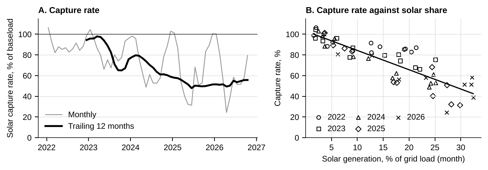

# Selling the Shape

**What German solar really earns, what the capture rate hides, and how much of the exposure a two hour battery hedges.** Day ahead market, Germany and Luxembourg bidding zone, 1 January 2022 to 31 October 2026.

Author: Mergim Manxholli, November 2026. Independent analysis based on public information as of 11 November 2026. Not investment advice.

The full note is in [`report/Selling_the_Shape_Mergim_Manxholli.pdf`](report/Selling_the_Shape_Mergim_Manxholli.pdf). This repository reproduces every number, table and figure in it.

## Findings

1. **Solar earns about half of baseload.** The capture price was 45.96 EUR/MWh in 2025 against a baseload of 89.32, a capture rate of 51%, down from 94% in 2022.
2. **The quoted capture rate is probably flattered by curtailment.** The official market value, computed by law on uncurtailed output, was 0.88 EUR/MWh lower in 2025 and about 5.9 lower in April 2026.
3. **Negative prices are structural.** 573 hours were negative in 2025 and 462 in January to October 2026. 24% of 2025 solar output was produced at negative prices.
4. **A two hour battery earned 87 thousand EUR per MW in 2025 on day ahead alone** (perfect foresight, before all costs). A rule that uses no forecast kept 88% of the perfect foresight margin.
5. **Storage hedges the shape.** A hedge ratio fitted on 2022 to 2024 cut the variance of the monthly shape P&L of a solar PPA by 53% out of sample. The ratio is a range, roughly 0.45 to 0.75 MW of two hour storage per GWh of annual solar volume.

## Contents

1. `report/` The note as PDF.
2. `data_raw/` Three SMARD market data exports in original (quarter hour) resolution, 1 January 2022 onward. Source: Bundesnetzagentur | SMARD.de, licence CC BY 4.0. Files as archived at https://github.com/henriklinkehl-blip/SMARD_Data (commit 92a2952 of 10 November 2026).
3. `data_ref/` Official reference figures used for validation, SMARD's current values for the months it has revised, and the day ahead prices for the five repeated clock change hours that the archived exports list only once. Sources are in `README_sources.txt`.
4. `scripts/` The pipeline: `smardio.py` (reader), `battery.py` (daily dispatch optimisation), `run_analysis.py` (all results), `make_figures.py`, `build_report.py` (PDF), `crosscheck.py` (comparison with independent pulls; documentation only, it needs the third party repositories named in the note and pyarrow, which are not part of this repository).
5. `out/` Results: `results.json`, `results_tables.xlsx`, one CSV per table, daily battery results, figures, the run log and the cross check log.

## Reproduce

Python 3.11 or later.

    pip install -r requirements.txt
    python scripts/run_analysis.py data_raw data_ref out
    python scripts/make_figures.py out data_ref
    python scripts/build_report.py out data_ref report/Selling_the_Shape_Mergim_Manxholli.pdf

The analysis takes about three minutes. `build_report.py` expects the Liberation Sans fonts in `/usr/share/fonts/truetype/liberation`; change `FONT_DIR` if they live elsewhere.

## Data vintage

SMARD revises realised generation and load for months after delivery. The archived exports hold each day as first published (as of 5 August 2026 for earlier days). On 11 November 2026 the monthly totals in the files matched SMARD's current series for every month except May to September 2026. `smardio.apply_smard_revisions` brings those months to SMARD's current values using the reference files in `data_ref/` (see `README_sources.txt`). It is switched on by `APPLY_REVISIONS = True` in `run_analysis.py`.

## Rebuild the inputs directly from SMARD

A fresh first hand download replaces both the archive and the revision step. I have not tested this route end to end, because the download centre cannot be scripted from where the analysis was built.

1. Open https://www.smard.de/home/downloadcenter/download-marktdaten/
2. Download three data sets as CSV, resolution "Originalauflösung" (quarter hour), from 1 January 2022 to 31 October 2026. If SMARD limits the period of one download, download in blocks and append them (keep one header line).
   * Oberkategorie "Markt", Datenkategorie "Großhandelspreise", Marktgebiet "Deutschland/Luxemburg". Save as `DayAhead_Preise_aktuell.csv`.
   * Oberkategorie "Stromerzeugung", Datenkategorie "Realisierte Erzeugung", Land "Deutschland". Save as `Realisierte_Erzeugung_Wind_PV_aktuell.csv`.
   * Oberkategorie "Stromverbrauch", Datenkategorie "Realisierter Stromverbrauch", Land "Deutschland". Save as `Realisierter_Stromverbrauch_Netzlast_aktuell.csv`.
3. Put the three files in `data_raw/`, set `APPLY_REVISIONS = False` in `scripts/run_analysis.py` and run the three commands above.

The reader takes five columns by exact name and ignores the rest: "Deutschland/Luxemburg [€/MWh]", "Photovoltaik [MWh]", "Wind Onshore [MWh]", "Wind Offshore [MWh]" and "Netzlast [MWh]" (or "Gesamt (Netzlast) [MWh]" in older exports). It stops with an error if one is missing. A complete export lists the repeated hour of the autumn clock change twice, in which case `clock_change_fill.csv` is not used. Numbers for recent months will move slightly with every later download; prices are final.

## Assumptions (all labelled in the note)

Battery of 1 MW and 2 MWh, round trip efficiency 85%, at most two full cycles a day, each day starts and ends empty, price taker, day ahead auction only, gross margins before all costs. Solar PPA scaled to 1 GWh per calendar year on the national profile.

## Data licence and attribution

Market data: Bundesnetzagentur | SMARD.de, licence CC BY 4.0. Official market values: transmission system operators, netztransparenz.de. All sources with dates are listed in Appendix B of the note and in `data_ref/README_sources.txt`.
